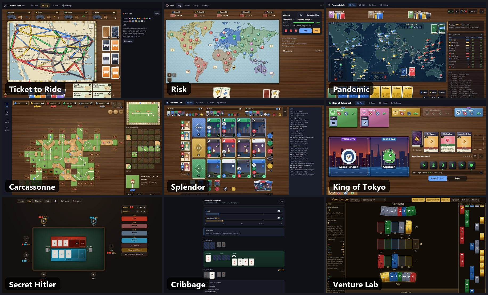

# Board & card games

31 board and card games and table companions, each its own web app. Play against computers or with friends online, with live odds, hints, sounds and real-table looks, on phone or laptop.

**[▶ Open the game hub](https://timothyhadfield.github.io/)** · works on phone and laptop

## All the games

### Board games

| Game | Play | Code |
|---|---|---|
| Ticket to Ride | [play](https://timothyhadfield.github.io/ticket-to-ride/) | [ticket-to-ride](https://github.com/TimothyHadfield/ticket-to-ride) |
| Risk | [play](https://timothyhadfield.github.io/risk/) | [risk](https://github.com/TimothyHadfield/risk) |
| Pandemic | [play](https://timothyhadfield.github.io/pandemic/) | [pandemic](https://github.com/TimothyHadfield/pandemic) |
| Carcassonne | [play](https://timothyhadfield.github.io/carcassonne/) | [carcassonne](https://github.com/TimothyHadfield/carcassonne) |
| Splendor | [play](https://timothyhadfield.github.io/splendor/) | [splendor](https://github.com/TimothyHadfield/splendor) |
| King of Tokyo | [play](https://timothyhadfield.github.io/king-of-tokyo/) | [king-of-tokyo](https://github.com/TimothyHadfield/king-of-tokyo) |
| Monopoly | [play](https://timothyhadfield.github.io/monopoly/) | [monopoly](https://github.com/TimothyHadfield/monopoly) |
| Evolution | [play](https://timothyhadfield.github.io/evolution/) | [evolution](https://github.com/TimothyHadfield/evolution) |
| 7 Wonders | [play](https://timothyhadfield.github.io/seven-wonders/) | [seven-wonders](https://github.com/TimothyHadfield/seven-wonders) |
| Catan Statistics | [play](https://timothyhadfield.github.io/catan-statistics/) | [catan-statistics](https://github.com/TimothyHadfield/catan-statistics) |

### Card games

| Game | Play | Code |
|---|---|---|
| Cribbage | [play](https://timothyhadfield.github.io/cribbage/) | [cribbage](https://github.com/TimothyHadfield/cribbage) |
| Venture Lab (Lost Cities) | [play](https://timothyhadfield.github.io/venture-lab/) | [venture-lab](https://github.com/TimothyHadfield/venture-lab) |
| Dominion | [play](https://timothyhadfield.github.io/dominion/) | [dominion](https://github.com/TimothyHadfield/dominion) |
| Texas Hold'em | [play](https://timothyhadfield.github.io/texas-holdem/) | [texas-holdem](https://github.com/TimothyHadfield/texas-holdem) |
| Hearts & Spades | [play](https://timothyhadfield.github.io/hearts-spades/) | [hearts-spades](https://github.com/TimothyHadfield/hearts-spades) |
| Skull King | [play](https://timothyhadfield.github.io/skull-king/) | [skull-king](https://github.com/TimothyHadfield/skull-king) |
| Cover Your Assets | [play](https://timothyhadfield.github.io/cover-your-assets/) | [cover-your-assets](https://github.com/TimothyHadfield/cover-your-assets) |
| Exploding Kittens | [play](https://timothyhadfield.github.io/exploding-kittens/) | [exploding-kittens](https://github.com/TimothyHadfield/exploding-kittens) |

### Party & hidden roles

| Game | Play | Code |
|---|---|---|
| Secret Hitler Companion | [play](https://timothyhadfield.github.io/secret-hitler-companion/) | [secret-hitler-companion](https://github.com/TimothyHadfield/secret-hitler-companion) |
| Codenames | [play](https://timothyhadfield.github.io/codenames/) | [codenames](https://github.com/TimothyHadfield/codenames) |
| Clocktower | [play](https://timothyhadfield.github.io/clocktower/) | [clocktower](https://github.com/TimothyHadfield/clocktower) |
| Coup | [play](https://timothyhadfield.github.io/coup/) | [coup](https://github.com/TimothyHadfield/coup) |
| Werewolf | [play](https://timothyhadfield.github.io/werewolf/) | [werewolf](https://github.com/TimothyHadfield/werewolf) |
| Wavelength | [play](https://timothyhadfield.github.io/wavelength/) | [wavelength](https://github.com/TimothyHadfield/wavelength) |

### Classics

| Game | Play | Code |
|---|---|---|
| Clue | [play](https://timothyhadfield.github.io/clue/) | [clue](https://github.com/TimothyHadfield/clue) |
| Battleship | [play](https://timothyhadfield.github.io/battleship/) | [battleship](https://github.com/TimothyHadfield/battleship) |
| Connect Four | [play](https://timothyhadfield.github.io/connect-four/) | [connect-four](https://github.com/TimothyHadfield/connect-four) |
| Stratego | [play](https://timothyhadfield.github.io/stratego/) | [stratego](https://github.com/TimothyHadfield/stratego) |
| Checkers | [play](https://timothyhadfield.github.io/checkers/) | [checkers](https://github.com/TimothyHadfield/checkers) |

### Dice

| Game | Play | Code |
|---|---|---|
| BANK Evolution | [play](https://timothyhadfield.github.io/bank-evolution/) | [bank-evolution](https://github.com/TimothyHadfield/bank-evolution) |
| BANK AI Trainer | [play](https://timothyhadfield.github.io/bank-ai-trainer/) | [bank-ai-trainer](https://github.com/TimothyHadfield/bank-ai-trainer) |

## How this works

This repo holds *only* the landing page. Each game keeps its own repository and its own
GitHub Pages deployment, so nothing here needs to stay in sync with any game's code.

Because every project publishes to `timothyhadfield.github.io/<repo-name>/`, this site sits
at the parent path of all of them — a visitor lands here, browses the cards, and clicks
through to whichever game they want.

## Adding a new game

1. Give the game its own repo with an `index.html` at the root.
2. Enable Pages on that repo (Settings → Pages → source: `main`, folder: `/`).
3. Copy an existing `<a class="card">` block in [`index.html`](index.html), change the
   href, emoji, title, description and tags, and push.
4. Add a row to the right table above.

That's the whole process — there is no build step and no dependency between the hub and
the games.
